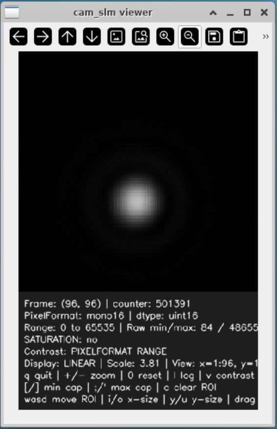
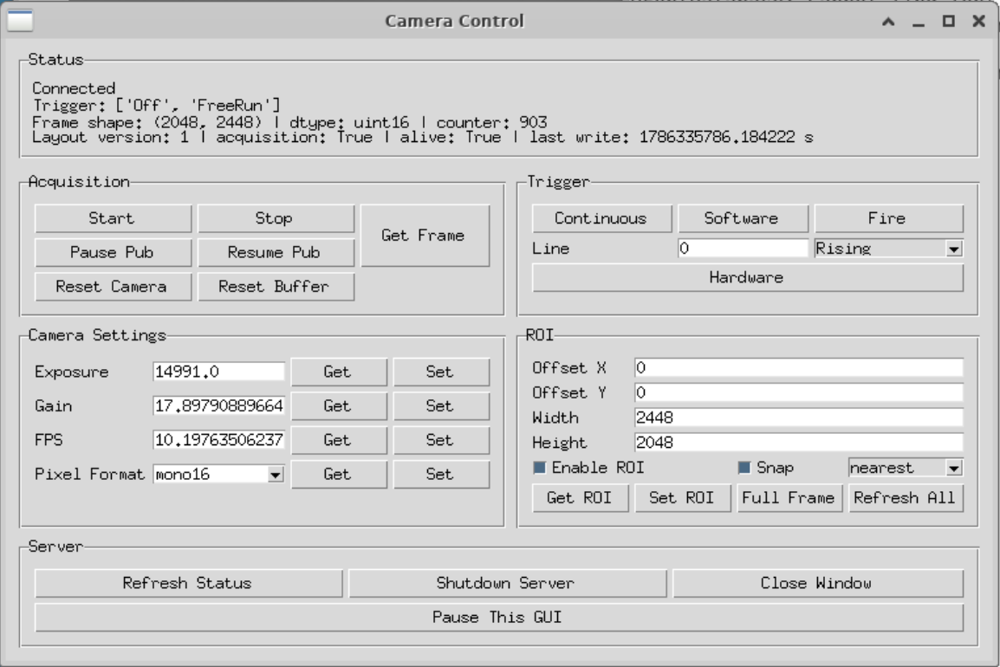
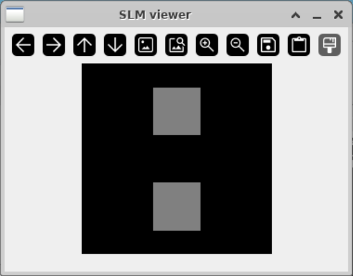

# Launch Servers, Viewers, and Control GUIs

JazLabs separates hardware access from viewing and control. A **server** owns
the hardware connection and keeps running while one or more **clients** read
its state, display live data, or send commands. A client can be a graphical
viewer, a control GUI, or Python experiment code. Starting the server first
ensures that none of these clients need to open the hardware directly.

The exact processes depend on where the hardware is connected:

- A camera server and its clients can run on the same computer.
- An SLM can use a hardware-facing server on Windows and a bridge/server on
  Linux. Linux clients then use the local bridge and shared-memory image.

Run every long-lived command in its own terminal or tmux window. The examples
below use `HDStokes` for the camera and `default_lab` for the bridged SLM.

## Before You Start

- Install JazLabs on every computer that will run a server, bridge, or client.
- Power on the hardware and install any required vendor drivers or SDKs.
- Check the selected file under `src/JazLabs/launchers/configs/`.
- Set `camera_serial_number` for every camera entry. JazLabs does not select a
  camera by discovery index; startup fails if the requested serial is missing
  or not detected.
- Confirm that configured hosts and ports are correct and not already in use.
- For a connection between computers, confirm that the hosts can reach each
  other and that the configured ports are allowed through their firewalls.

The server and clients must use matching configuration values. A server can
bind to `0.0.0.0` to accept remote connections, but a client must connect to a
real host name or IP address rather than `0.0.0.0`.

## General Workflow

Bringing a supported instrument online normally follows the same pattern:

1. Add or select a hardware entry in a launcher configuration. Define its
   hardware type or identifier, server host, command port, and any data-stream
   ports or shared-memory names required by that instrument stack.
2. Start the hardware-facing server and leave it running. This process owns the
   vendor driver and physical device connection.
3. Start the matching viewer or control GUI with the same configuration. Use
   it to confirm that data and status are updating.
4. Connect experiment code through the instrument's client class, using the
   same host, ports, and stream settings as the server.
5. Close client objects when the experiment finishes, then stop the server.

The camera and SLM examples below show this pattern with two different data
paths: local camera shared memory and a networked SLM bridge.

The Time Tagger follows the same server/bridge/client model without a
continuous shared-memory stream. See the dedicated
[`Time Tagger server, bridge server, and client`](time-tagger-server-bridge-client.md)
guide for its launch commands and Python client example.

Minimal Python clients for the other instrument stacks are indexed in the
[`Instrument Client Examples`](instrument-client-examples.md) guide.

## Example 1: Camera Server and Clients on One Computer

In this arrangement, the camera, server, live viewer, and control GUI are all
on the camera computer:

```text
Camera hardware
      |
      v
Camera server
      |
      +----> Live image viewer
      |
      `----> Camera control GUI
```

The `HDStokes` configuration sets `CAMERA_HOST` to `127.0.0.1`, so the clients
connect back to the server on the same computer.

### 1. Start the camera server

In the first terminal, run:

```bash
jazlabs-server-camera --config HDStokes --name cam_slm
```

The server opens the configured camera, creates the frame stream, and listens
on the configured command and frame-publication ports. Wait until it reports
that it is running, then leave this terminal open.

### 2. Start the client viewer and control GUI

In a second terminal on the same computer, run:

```bash
jazlabs-view-camera --config HDStokes --name cam_slm
```

This client launcher opens two windows:

- the live viewer, which displays frames received from the server; and
- the control GUI, which reads camera status and sends acquisition, trigger,
  exposure, gain, frame-rate, pixel-format, and ROI commands to the server.

The client is connected when the GUI reports `alive: True`. During continuous
acquisition it should also report `acquisition: True`, and the viewer's frame
counter should keep increasing.



The information panel beneath the image shows the frame shape and counter,
pixel format, raw minimum and maximum, saturation state, display contrast,
zoom, cursor value, and any selected display ROI. Contrast and zoom affect the
viewer only; hardware acquisition settings are changed through the control
GUI.



The control GUI communicates with the server rather than opening the camera
itself. This allows the server to remain the single owner of the hardware
connection.

To open only one client window, use:

```bash
# Live image only
jazlabs-view-camera --config HDStokes --name cam_slm --no-widget

# Camera controls only
jazlabs-view-camera --config HDStokes --name cam_slm --no-viewer
```

To open clients for all camera entries that are enabled in the configuration,
start their servers first and then run:

```bash
jazlabs-view-camera --config HDStokes --all
```

### 3. Connect from Python code

Experiment code connects to the same camera server as the viewer and GUI. It
must use the server's reachable host, command port, and frame-publication port.
For `cam_slm` in the `HDStokes` configuration, a minimal client is:

```python
from JazLabs.hardware.Cameras.Camera_Client import CameraClient


camera_client = None

try:
    camera_client = CameraClient(
        host="127.0.0.1",
        command_port=50733,
        frame_pub_port=50734,
        timeout_ms=60_000,
        client_id="camera_connection_example",
    )

    print("Server alive:", camera_client.IsServerAlive())
    print("Camera serial number:", camera_client.GetSerialNumber())
    print("Exposure [us]:", camera_client.GetExposureTime())

    previous_counter = camera_client.GetFrameCounter()
    frame = camera_client.GetFrame(
        WaitForNewFrame=True,
        LastFrameCounter=previous_counter,
    )
    print("Received frame:", frame.shape, frame.dtype)
finally:
    if camera_client is not None:
        camera_client.close()
```

The two ports have different jobs:

- `command_port` carries requests and replies, such as reading exposure or
  changing trigger mode.
- `frame_pub_port` announces new frames; the client reads the corresponding
  image from server-owned shared memory.

These values must match the selected entry in `CAMERA_SERVERS`. This camera
example deliberately runs the server and client on the same computer because
the current camera stack stores frame pixels in local shared memory. Changing
`127.0.0.1` to a remote IP is not enough to make that shared memory available
on another computer; use the camera bridge stack when remote frame access is
required. Give concurrent clients distinct `client_id` values so server logs
and errors identify the caller.

Always close the client in a `finally` block. Closing a client releases its
network sockets and shared-memory attachments; it does not shut down the
camera server or prevent another client from remaining connected.

## Example 2: SLM Server with a Linux Bridge and Viewer

The SLM example spans two computers. The SLM server owns the physical SLM.
The SLM bridge connects to the server, creates the local SLM
shared-memory stream, and forwards image and control traffic. The Linux viewer
reads the current image from that shared memory.

```text
Physical SLM
     |
     v
SLM server (Windows)
     |
     | network: commands, images, acknowledgements
     v
SLM bridge (Linux)
     |
     +----> Local SLM client and phase-mask procedures
     |
     `----> Shared memory ----> Linux SLM viewer
```

The order matters: start the hardware-facing server first, the bridge
second, and the Linux viewer or other clients last. The commands below use the
`SLM_MILK_SERVER`, `SLM_MILK_BRIDGE`, and `SLM_MILK_SHM_NAME` settings in
`default_lab.py`. These optional pyMilk settings are commented out by default;
uncomment them before running the pyMilk commands.

### 1. Start the hardware-facing server on Windows

On the computer physically connected to the SLM, open PowerShell in the
JazLabs environment and run:

```powershell
jazlabs-server-slm-milk --config default_lab
```

Wait until the server has opened the SLM and reports its command, image, and
acknowledgement ports. Leave the PowerShell window open.

### 2. Start the bridge on Linux

On the Linux computer, run:

```bash
jazlabs-bridge-slm-milk --config default_lab
```

The bridge connects to the SLM server configured by `server_host`, creates
the stream named by `shm_name`, and exposes a local command port for JazLabs
SLM clients. Wait until its startup information has been printed before
opening the viewer.

### 3. Start the client viewer on Linux

In another Linux terminal, run:

```bash
jazlabs-view-slm-milk --config default_lab
```

The viewer reads the configured shared-memory stream and displays the image
currently being sent to the SLM. Apply or update a safe test mask through a
normal JazLabs SLM client or procedure and confirm that the displayed image
changes.



This window shows what is present in the Linux shared-memory stream. A changing
viewer confirms that the local client/bridge path is active; also check the
bridge and SLM-server terminals for display acknowledgements or errors
when confirming that the physical SLM updated.

## Example 3: Laser Server, GUI, and Client

Configure a laser entry in `src/JazLabs/launchers/configs/HDStokes.py`. On the
computer connected to the laser, start the named server:

```bash
jazlabs-server-laser --config HDStokes --name tunable_laser
```

For clients on another computer, configure the server to bind to `0.0.0.0` and
allow the command port through the hardware computer's firewall. Then launch
the control GUI with the hardware computer's reachable address:

```bash
jazlabs-view-laser \
    --config HDStokes \
    --name tunable_laser \
    --host 192.168.1.25
```

Python code uses the same address and configured command port:

```python
from JazLabs.hardware.Lasers.Laser_Client import LaserClient

laser = LaserClient(host="192.168.1.25", command_port=50931)
laser.set_wavelength_nm(1550.0)
print(laser.get_power())
laser.close()
```

Only request values that are safe for the connected laser and optical setup.
The physical interlock and operating procedure remain authoritative. A driver
that does not implement a control reports that capability as unavailable.

## Example 4: Motor Server, Bridge, and Control GUI

Motors follow the same separately launched server/bridge/client pattern as the
other instruments. The widget never starts a server or opens a serial port.

```text
Serial motor controller
        |
        v
Motor server (hardware computer)
        |
        +----> Motor client / GUI on the same computer
        |
        `----> Motor bridge (control computer)
                       |
                       +----> Motor control GUI
                       `----> Motor client / experiment notebook
```

There is no continuous image stream or shared memory for motors. Commands and
position/status snapshots travel over the command endpoint. All serial commands
stay in the stage driver; the hardware server schedules motion and polls status.
Users can also instantiate a serial driver directly from a script when a server
is not wanted. The widget always uses the client.

### 1. Configure the mount

The presets in `src/JazLabs/launchers/configs/motorised_mounts.py` use
`MOTOR_SERVERS`, with one named entry per controller:

| Name | Controller | Axes and displayed units | Server port | Local bridge port |
|---|---|---|---:|---:|
| `newport_tip_tilt` | CONEX-AGAP / AG-M100D | U = yaw, V = pitch; degrees | 50941 | 51941 |
| `newport_translation` | CONEX-AGP | X; configured physical units, labelled mm in the preset | 50942 | 51942 |
| `thorlabs_umc2` | UMC2 | Separate mounts X/Y; counts and calibrated mm | 50943 | 51943 |
| `simulation` | Simulated translation stage | X/Y; mm | 50944 | 51944 |

For serial hardware, install `pip install -e '.[serial]'`, then replace
`stage_kwargs.port = None` with the hardware computer's port, such as `COM5` or
`/dev/ttyUSB0`. A `--serial-port` override is also available. Close Kinesis,
Newport's GUI, and other programs using that port first. These drivers use
pyserial directly and do not require a VISA backend. The AGP translation preset
is not an AG-UC8 driver; check the controller model before selecting it.

Configure these fields for the selected mount:

- `host` / `command_port`: where the hardware server binds.
- `client_host`: reachable hardware-server address for a direct client.
- `stage_type` / `stage_kwargs`: controller selection and driver settings.
- `limits`: calibrated lower/upper endpoints for each axis in displayed units.
  Leave them empty until measured; a slider is disabled without both endpoints.
- `local_host` / `local_command_port`: where a bridge binds on the control computer.
- `remote_host`: the hardware-server address a bridge connects to; it can also
  be supplied using `--remote-host`.

The UMC2 driver queries each bay's stage-axis parameters (`0x04F1/0x04F2`) on
connection. It exposes the reported part number, stage serial number, scale and
travel endpoints through `GetMotionCapabilities()`. These are controller-reported
parameters; they may reflect an assigned stage profile rather than identifying
an arbitrary attached mechanism. No homing, movement or parameter writes occur
during detection. Restart the server after changing fitted stages.

Each UMC2 bay is shown as a separate mount panel in the same GUI, with its own
label, units selector, relative step, target and slider. The units selector is
beside the position readout. The GUI prefers mm when calibrated, even if the
server's canonical units are counts, and converts a custom step when units change.
Without counts/mm calibration, it shows a disabled counts selector and an explicit
millimetre-unavailable message. Both panels share one server and COM port. The current scheduler performs one move at a time; keyboard
A/D controls the first mount and W/S the second. STOP ALL AXES stops both mounts.

In `stage_kwargs.mounts`, declare `physical_units="mm"` for each fitted linear
stage/actuator. The packet's counts-per-unit value does not distinguish mm from
degrees. With `units="auto"`, usable millimetre calibration selects mm as the
server's canonical units; otherwise the mount stays in counts and the GUI explains
what is missing. Detection is read-only and can be disabled with `detect_stages=False`.
Use a verified `counts_per_mm` override and optional `limits_mm` if the controller
cannot report its calibration. Configured limits cannot widen detected travel.

The driver reports `unit_scales`, `limits_by_unit`, `resolution_by_unit` and
`step_by_unit` for each mount. Resolution is one native count. The suggested jog
step is an application default (0.01 mm or 100 counts, reduced for short travel),
not a motor specification; override each mount's `step` in its canonical units.
A stage's maximum velocity/acceleration fields are retained with their raw
counts-per-controller-cycle units; they do not enable GUI speed control.

KST201 uses its existing actuator profile for mm and counts. KDC101 and BSC203
accept explicit `counts_per_mm`, `units` and `limits` driver options; BSC203 accepts
a per-axis calibration dictionary. Their limits use the selected canonical units.
Do not copy calibration between different stages or controller types. For an
actuator driving an angular mount, mm refers to actuator displacement, not angle.
Verify the AGP stage's configured units: `units="mm"` is a label, not firmware
configuration or calibration.

Client examples for a calibrated Thorlabs mount:

```python
mount.GetPosition("X", units="mm")
mount.GetPosition("X", units="counts")
mount.GetPositions(units="mm")
mount.GetMotionCapabilities()  # Detected identity, limits, scales and suggested steps.
# mount.MoveTo("X", 1.0, units="mm")  # Waits for completion by default.
# mount.MoveTo("X", 1000, units="counts")
```

An omitted `units` uses the axis's advertised canonical units. Unavailable unit
conversions raise an error rather than assuming a scale. Low-level `MoveAbs` and
`MoveRel` methods remain native count operations; `MoveTo` is the calibrated API.

### 2. Start the motor server on the hardware computer

For the tip/tilt mount:

```bash
jazlabs-server-motor --config motorised_mounts --name newport_tip_tilt --serial-port COM5
```

For the other hardware presets, in separate terminals as needed:

```bash
jazlabs-server-motor --config motorised_mounts --name newport_translation --serial-port COM6
jazlabs-server-motor --config motorised_mounts --name thorlabs_umc2 --serial-port COM7
```

Replace the serial port names with the actual ones, or omit `--serial-port`
once they are saved in the config. The server owns that serial port until it
stops. Driver startup does not home or enable the motors. The GUI will report
connection/startup failures rather than assume that hardware is ready.

To accept clients or a bridge from another computer, add `--host 0.0.0.0` and
allow the configured command port through the firewall on a trusted lab network.
Clients must use the computer's real address, not `0.0.0.0`. The motor protocol
has no authentication; do not expose it to an untrusted network.

### 3. Open the motor control GUI

With the server running, open another terminal on the same computer:

```bash
jazlabs-view-motor --config motorised_mounts --name newport_tip_tilt
```

The black control GUI offers an **alignment** pad and an **axis console**:

```bash
jazlabs-view-motor --config motorised_mounts --name newport_translation --layout console
```

For a direct connection from a different computer, supply its reachable address:

```bash
jazlabs-view-motor --config motorised_mounts --name newport_tip_tilt --host 192.168.1.25
```

The GUI reports live position, homed/needs homing, homing, moving, disabled,
fault, and stale-feedback states. AGAP absolute sensors require no homing.
Use **Enable axis** if needed before homing or moving an incremental stage.

- Enable **Keyboard control**: A/D jog the first axis, W/S the second, and Q/E
  the third. A tap sends one configured relative step; holding repeats one step
  at a time after the preceding move completes. Rapid taps while busy retain
  only the latest pending step instead of accumulating a long movement queue.
  Release finishes the current step and cancels further held-key repetition.
  Choose a small step for fine alignment.
- Absolute targets use the axis's displayed units. Slider dragging previews a
  target; release sends one absolute move within the configured travel limits.
- Speed controls are available only when the driver advertises support. The
  simulator supports them; physical-unit velocity configuration is currently
  unavailable through the serial drivers, so those controls remain disabled.
- Escape or **STOP ALL AXES** sends controller stop commands, clears pending
  motion, and latches motion off. **Re-enable motion** requires stopped feedback.
  This button clears the server's stop latch; **Enable axis** controls the
  controller's motor enable separately. Automatic stops show their triggering
  reason in the GUI and terminal. The snapshot retains `last_stop_reason` after
  re-enabling so a first-move failure can be diagnosed.
  This software stop cannot replace a physical emergency stop or deliver a
  command over a disconnected serial link.

Editing a value, changing layout, minimizing, or losing application focus
releases/disarms keyboard jogging. Held-key requests expire at the hardware
server after 350 ms without renewal, so a lost client cannot queue endless jog
steps. A step or absolute move already accepted by hardware can still finish.
Closing the GUI requests a stop and closes its client; the server stays running.

### 4. Optional: bridge to the control computer

Start the hardware server first with a reachable bind address. Then, on the
control computer, start the bridge in a second terminal:

```bash
jazlabs-bridge-motor --config motorised_mounts --name newport_tip_tilt --remote-host 192.168.1.25
```

The preset above forwards local `127.0.0.1:51941` to the hardware server's
`192.168.1.25:50941`. Distinct local ports also allow server and bridge testing
on the same computer. Override ports using `--local-command-port` and
`--remote-command-port` when needed, and give clients the matching local port.

In another terminal on the control computer:

```bash
jazlabs-view-motor --config motorised_mounts --name newport_tip_tilt --bridge
```

The bridge forwards requests and replies and never imports a hardware driver.
It preserves position-feedback age and adds its relay time. A timed-out movement
request has an unknown outcome and is never automatically retried. Keep the
link responsive for held-key jogging; use `--timeout-ms` only to change the
finite request timeout, not the hardware server's jog lease.

### 5. Use a client or the notebook

A script connects to the same server or bridge endpoint as the GUI:

```python
from JazLabs.hardware.MotorisedStages.MotorisedStage_Client import MotorisedStageClient

# Direct server: 50941. Local bridge: 51941.
mount = MotorisedStageClient(host="127.0.0.1", command_port=51941)
try:
    print(mount.GetMotionCapabilities())
    print(mount.GetPosition("U"))       # One position, in degrees for this mount.
    print(mount.GetPositions())          # {"U": ..., "V": ...}
    print(mount.GetAxisStatus("U"))      # Position plus moving/homed/enabled/fault status.
    # mount.MoveTo("U", 0.1)             # Waits for stopped/target feedback by default.
    # mount.MoveTo("U", 0.1, wait=False) # Submit without waiting; poll status yourself.
    # mount.StopAll()
finally:
    mount.close()
```

The notebook `notebooks/instrument_clients/motorised_mount_client.ipynb` contains
short client examples, like the camera notebook. Set `HOST`, `COMMAND_PORT` and
`AXIS` to match your server (or the bridge's local endpoint). It reads positions
and status; uncomment individual move, home or stop examples when needed.
CONEX-AGP Home is available only when referencing is needed. An already referenced
controller rejects another home command in READY, so the GUI disables that button.
Enable **Keyboard control** to use A/D for the first axis, W/S for the second,
and Q/E for the third. Holding a key continues movement; releasing it stops jogging.
Typing in a number field disarms keyboard movement; enable the checkbox again to resume.

`GetPosition(axis)` returns a current position and `GetPositions()` returns an
axis-to-position dictionary in the advertised units. `GetAxisStatus(axis)` adds
moving, homed, enabled and fault information. Position-only reads reject stale
or unavailable feedback.

`MoveTo(axis, target, wait=True, timeout=None)` waits for that specific operation
to complete and returns its stopped axis status. The default timeout comes from
the controller's `move_timeout`, or 60 seconds. Faults, rejected moves, stop,
lost feedback and timeout raise instead of reporting success; a deadline or
unavailable feedback triggers a stop request. The client polls completion, so
the server remains responsive to a GUI or another client's Stop command. Direct
serial-driver `MoveTo` calls also wait by default; the server explicitly uses
`wait=False` when scheduling them.

With `wait=False`, `MoveTo` returns an `operation_id` after submission; the
corresponding record is in `request("state")["operations"]`. Lower-level
`request("absolute", ...)`, `request("relative", ...)`, and `HomeAxis` still
acknowledge submission rather than movement completion. Poll status and errors
when using those asynchronous operations. Existing driver `MoveAbs`/`MoveRel`
retain their own documented wait options and native units. Never blindly retry
a relative move after a communication timeout.
Closing a synchronous notebook/script client does not stop the server or an
active move; explicitly request `StopAll()` when that is your intention.

For a hardware-free test, use two terminals:

```bash
# Terminal 1
jazlabs-server-motor --config motorised_mounts --name simulation

# Terminal 2
jazlabs-view-motor --config motorised_mounts --name simulation
```

The three independent module launchers can also be used without console scripts:

```bash
python -m JazLabs.launchers.launch_motorised_stage_server --config motorised_mounts --name simulation
python -m JazLabs.launchers.launch_motorised_stage_bridge --config motorised_mounts --name simulation --remote-host 127.0.0.1
python -m JazLabs.launchers.launch_motorised_stage_widget --config motorised_mounts --name simulation --bridge
```

Run each in its own terminal, in the order shown. Reinstall the editable project
with `pip install -e .` if the new `jazlabs-server-motor`, `jazlabs-bridge-motor`,
and `jazlabs-view-motor` entry points are not yet available in your environment.

## Launch Order at a Glance

### Same-computer camera

| Order | Computer | Process | Command |
|---:|---|---|---|
| 1 | Camera computer | Camera server | `jazlabs-server-camera --config HDStokes --name cam_slm` |
| 2 | Camera computer | Viewer and control clients | `jazlabs-view-camera --config HDStokes --name cam_slm` |

### Bridged SLM

| Order | Computer | Process | Command |
|---:|---|---|---|
| 1 | Windows SLM computer | Hardware-facing server | `jazlabs-server-slm-milk --config default_lab` |
| 2 | Linux computer | SLM bridge | `jazlabs-bridge-slm-milk --config default_lab` |
| 3 | Linux computer | Shared-memory viewer client | `jazlabs-view-slm-milk --config default_lab` |

### Networked laser

| Order | Computer | Process | Command |
|---:|---|---|---|
| 1 | Laser computer | Laser server | `jazlabs-server-laser --config HDStokes --name tunable_laser` |
| 2 | Control computer | Laser GUI | `jazlabs-view-laser --config HDStokes --name tunable_laser --host <laser-host>` |

### Bridged motor mount

| Order | Computer | Process | Command |
|---:|---|---|---|
| 1 | Hardware computer | Motor server | `jazlabs-server-motor --config motorised_mounts --name newport_tip_tilt --host 0.0.0.0` |
| 2 | Control computer | Motor bridge | `jazlabs-bridge-motor --config motorised_mounts --name newport_tip_tilt --remote-host <motor-host>` |
| 3 | Control computer | Motor GUI | `jazlabs-view-motor --config motorised_mounts --name newport_tip_tilt --bridge` |

## Stopping the Processes

Close GUI windows normally. For a long-running server, bridge, or terminal
viewer, return to its terminal and press `Ctrl+C`. Stop clients before their
server so they do not continue waiting for a connection that has disappeared.
For motors, close the GUI/clients first, then the bridge, then the hardware
server. `shutdown_bridge` sent to a motor bridge stops only that bridge;
`shutdown` requests shutdown of the hardware server. The server requests a stop
before closing the serial port.

## Troubleshooting

- **A client times out:** check that the server or bridge is still running and
  that both processes use the same host and port values.
- **The camera client cannot connect on the same computer:** confirm that both
  commands use the same configuration and camera name, and that
  `CAMERA_HOST` is `127.0.0.1` or another local address.
- **The camera window opens but does not update:** confirm that the GUI reports
  `alive: True` and `acquisition: True`, and watch whether the frame counter
  advances.
- **The SLM bridge cannot reach the server:** verify `server_host`, the
  three Windows ports, firewall rules, and that the Windows server was started
  first.
- **The SLM viewer reports missing shared memory:** wait for the Linux bridge
  to create the configured stream and confirm that the viewer and bridge use
  the same `SLM_MILK_SHM_NAME` or `shm_name`.
- **The SLM viewer changes but the hardware does not:** inspect the Linux
  bridge and Windows server for acknowledgement or LUT/hardware errors. The
  viewer alone proves that shared memory changed, not that the SLM accepted the
  image.

- **Motor sliders are unavailable:** set calibrated axis endpoints in `limits`;
  no range is invented for an unknown fitted stage.
- **Motor moves are disabled:** check the connection age, homing and enable
  indicators, controller errors, and the latched stop state.
- **Motor GUI reaches the wrong endpoint:** use the server port for a direct
  connection, or `--bridge` / its local command port for a bridged connection.
